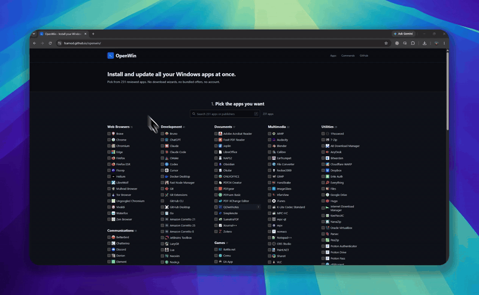

# OpenWin


A small app picker for Windows. Tick what you need, copy the `winget` commands, and paste them into Windows Terminal. No account, no installer, no analytics.

[](docs/openwin-demo.mp4)

231 apps in 11 categories. Search by name, publisher, package ID, description, or category. Each app has a details dialog with its package ID and homepage, and the selection can be shared through the URL. The site follows your system theme. Pull the cord in the header to switch, or use the small button on a phone.

## Running it

Node.js 20.19 or newer, or 22.12 or newer.

```cmd
git clone https://github.com/fsamod/openwin.git
cd openwin
npm ci
npm run dev
```

Open `http://localhost:5173`.

`npm run check` runs the tests and a production build. `npm run preview` serves the built site.

## Catalog

The list lives in [`src/data/apps.json`](src/data/apps.json). Each entry has a package ID, name, publisher, description, homepage, category, source, and icon. `preview: true` marks beta or preview releases. Icons are in `public/icons/`.

Package IDs were last checked against winget 1.29.380 on 9 November 2026. To check one yourself:

```cmd
winget show --id <package-id> --exact --source <winget-or-msstore> --accept-source-agreements
```

If you want to add or change something, read [`CONTRIBUTING.md`](CONTRIBUTING.md).

## Notes

The site is plain HTML, CSS, and JavaScript built with Vite. There is no framework, backend, or database. The only storage is local: selected apps, language, and theme.

The picker is available in English and German. The information pages are English only.

Privacy, security, and the longer explanation are on the site: [privacy](https://fsamod.github.io/openwin/privacy.html), [security](https://fsamod.github.io/openwin/security.html), [why OpenWin](https://fsamod.github.io/openwin/why.html).

For questions or catalog fixes, email [fsamod@proton.me](mailto:fsamod@proton.me) or open an issue. Don't put exploit details in a public issue; see [`SECURITY.md`](SECURITY.md).

## Support

OpenWin is free and built in my spare time. Tips are optional:

- **Solana:** `HntwBQHT4LqKMCPjib8zkvQHqcfWZQ65DJyrsTisMCSy`
- **Ethereum:** `0x328373857c3932f9edeb0918b46884f57a99a00`
- **Bitcoin:** `bc1pyzzlumc4j4p0khv78zfsnc04skfrvj5j80zl3actuhen247zru4js9ulj52`

## License

MIT. App names, icons, and metadata belong to their publishers. OpenWin is not affiliated with Microsoft, Ninite, or any app publisher.
