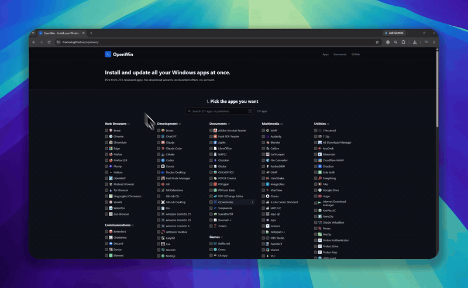

# OpenWin


A dark, Ninite-style app picker for Windows. Choose from a fixed list of 231 reviewed apps and copy exact `winget install` commands for the ones you need.

[](LICENSE)
[](https://fsamod.github.io/openwin/)

- **Website:** [fsamod.github.io/openwin](https://fsamod.github.io/openwin/)
- **Repository:** [github.com/fsamod/openwin](https://github.com/fsamod/openwin)
- **Issue tracker:** [github.com/fsamod/openwin/issues](https://github.com/fsamod/openwin/issues)

## Demo

[](docs/openwin-demo.mp4)

Click the preview to open the full video.

## What it does

OpenWin presents a reviewed set of Windows apps in 11 categories. Pick what you need, review the commands, then copy them into Windows Terminal. The site never runs anything on your PC.

- **Fixed catalog:** 231 apps across browsers, communications, development, documents, games, Microsoft tools, multimedia, professional tools, self-hosted software, utilities, and system utilities.
- **Exact commands:** one `winget install` command per selected app, using the correct `winget` or `msstore` source.
- **Search and details:** find apps by name, publisher, or package ID. Each app has a details dialog with its package ID and homepage.
- **Shareable selections:** the selected app list is stored in the URL and in local storage.
- **No account or analytics:** the site is static and makes no third-party requests. Icons are served locally.

## Run locally

```cmd
git clone https://github.com/fsamod/openwin.git
cd openwin
npm install
npm run dev
```

Open `http://localhost:5173`.

## Development

```cmd
npm test
npm run build
npm run preview
```

The catalog is a fixed list in [`src/data/apps.json`](src/data/apps.json); icons live in `public/icons/`. Pushes to `main` deploy through GitHub Pages.

## Contributing

Bug reports and focused pull requests are welcome. Run `npm test` and `npm run build` before opening a pull request.

## Support

OpenWin is free and built in my spare time. If it saved you a fresh-install headache, you can tip in crypto:

- **Solana:** `HntwBQHT4LqKMCPjib8zkvQHqcfWZQ65DJyrsTisMCSy`
- **Ethereum:** `0x328373857c3932f9edeb0918b46884f57a99a00`
- **Bitcoin:** `bc1pyzzlumc4j4p0khv78zfsnc04skfrvj5j80zl3actuhen247zru4js9ulj52`

Tips are voluntary and never unlock anything.

## License

OpenWin is open-source software licensed under the [MIT License](LICENSE). Package metadata and app icons belong to their respective publishers. OpenWin is not affiliated with Microsoft, Ninite, or any app publisher.
